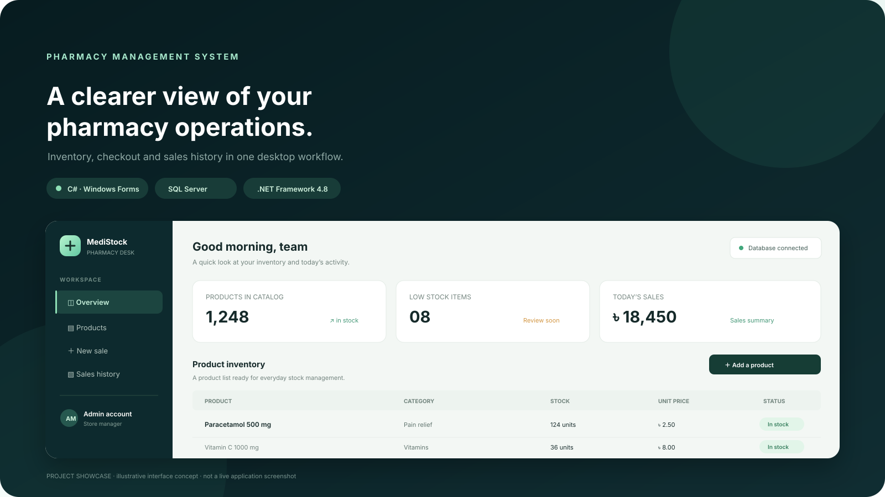

<div align="center">

# Pharmacy Management System

**A desktop application for managing pharmacy products, users, checkout, and sales records.**

Built with **C# · Windows Forms · .NET Framework 4.8 · SQL Server**



*Project showcase illustration. It presents the product workflow; it is not a screenshot of the current application UI.*

</div>

---

## What it does

The application provides role-based entry points for pharmacy administration and day-to-day sales work.

- **Product inventory** — add, search, edit, and remove products, including company, quantity, and price.
- **Checkout** — find products, build a bill, enter customer details, calculate totals, and reduce stock after a sale.
- **Sales history** — review saved customer and bill records.
- **User administration** — add, search, update, and remove user records, with Admin and Manager roles.
- **SQL Server storage** — stores users, products, bill line items, and completed sale records.

## Technology

| Area | Stack |
| --- | --- |
| Desktop UI | C# Windows Forms |
| Runtime | .NET Framework 4.8 |
| Database | Microsoft SQL Server / SQL Server Express |
| Data access | ADO.NET (`System.Data.SqlClient`) |
| Project | Visual Studio solution included in the source archive |

## Get started

### Requirements

- Windows
- Visual Studio with the **.NET desktop development** workload
- .NET Framework 4.8 targeting pack
- SQL Server or SQL Server Express, plus SQL Server Management Studio (SSMS) or another SQL script runner

### Set up the database

1. Create or select a SQL Server instance that your Windows account can access.
2. Open [`database.sql`](database.sql) in SSMS and review the database file locations near the beginning of the script. Change them to paths that exist on your machine, or adjust the database creation step to match your SQL Server setup.
3. Execute the script to create the `pharmacy managment system` database and its tables.

### Open the application

1. Extract [source archive](<finalProject(pharmacy managment system).zip>) to a working folder.
2. In the extracted `finalProject(pharmacy managment system)` directory, open `finalProject(pharmacy managment system).sln` in Visual Studio.
3. Update the SQL Server connection settings in `App.config` **and** `DataAccess.cs` to use your local instance and database. Do not commit credentials.
4. Build and run the solution from Visual Studio.

> The bundled project is configured for a particular developer machine. A local SQL Server connection must be set up before the application can access data.

## Database tables

The supplied SQL script defines four application tables:

- `Product` — product name, company, quantity, and unit price.
- `UserInfo` — user profile, user ID, password, and role.
- `Bilinginfo` — line items staged for checkout.
- `Billhold` — customer details, date, and completed bill total.

## Project layout

```text
.
├── database.sql
├── finalProject(pharmacy managment system).zip  # Visual Studio source and project files
└── assets/
    └── pharmacy-workspace.svg                    # README showcase illustration
```

## Security and project status

This is a learning project and needs security work before real-world use. The bundled implementation stores account passwords as plain text and includes machine-specific database connection settings. Replace any existing database credentials, use a least-privilege SQL account, and avoid committing secrets. Some database operations build SQL from input strings; parameterized queries should be used consistently before handling real data.

## License

No license file is currently included. Contact the repository owner before redistributing or using this project beyond the rights granted by the applicable law.
