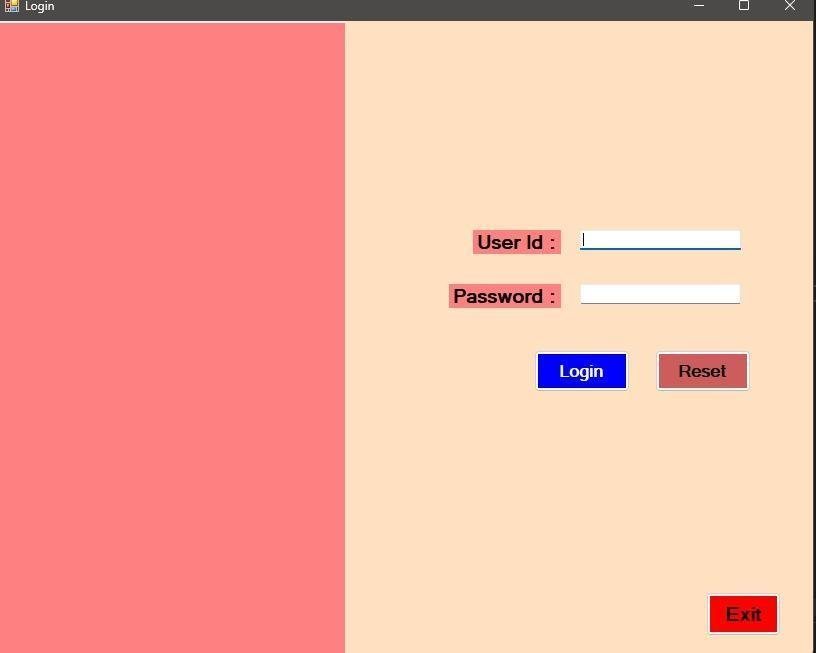
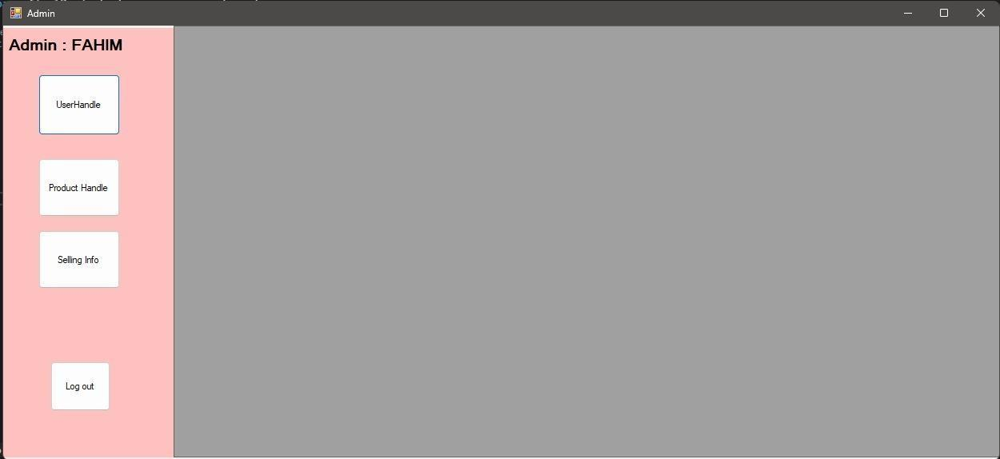
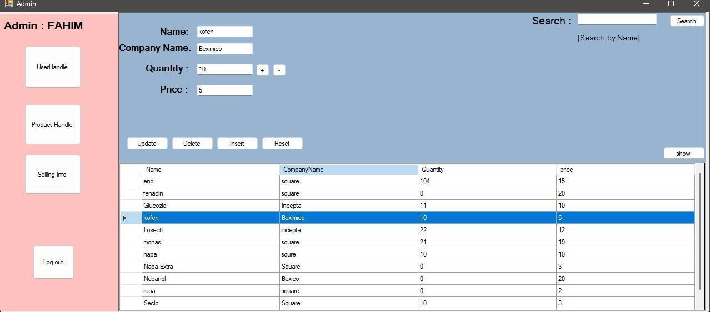
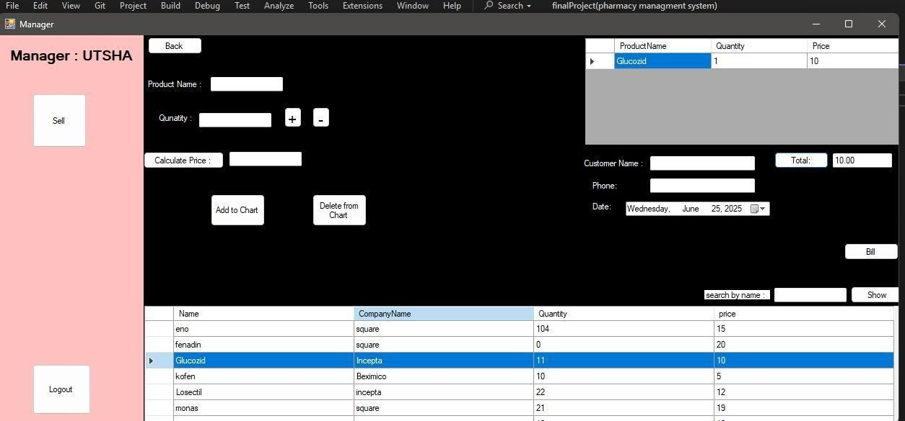
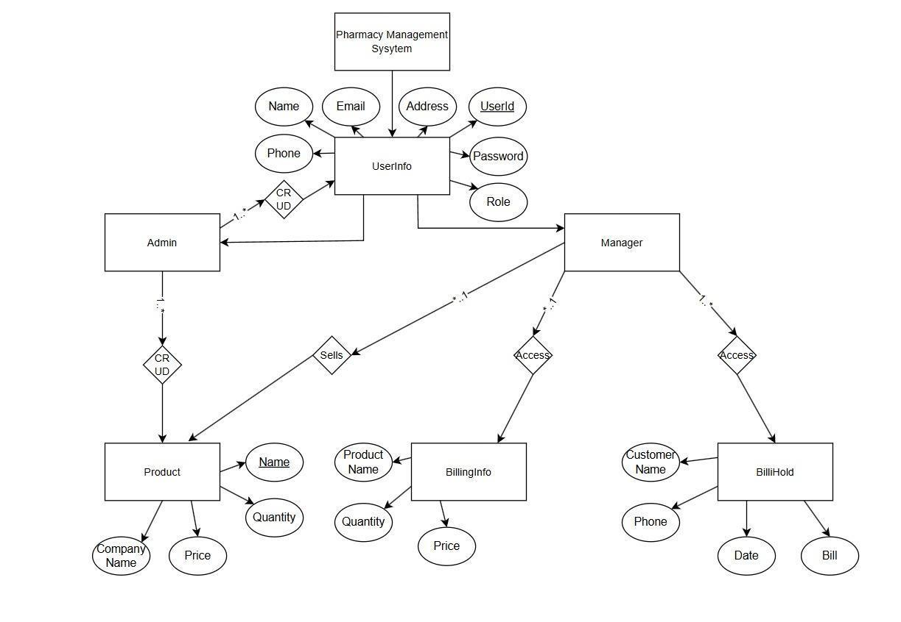

<div align="center">

# Pharmacy Management System

**A Windows desktop application for pharmacy administration, inventory, and checkout.**

C# · Windows Forms · .NET Framework 4.8 · SQL Server

</div>

## Screenshots

The screens below are taken from the project report.

| Login | Administrator workspace |
|:---:|:---:|
|  |  |
| Product management | Manager checkout |
|  |  |

## Overview

The project is a role-based pharmacy management application built as a Windows Forms desktop program. Administrators can manage users and products and review saved sales. Managers can work with the product list, prepare a bill, and complete a sale.

### Included workflows

- **Sign-in:** routes Admin and Manager accounts to their respective workspaces.
- **User management:** add, search, edit, and remove user records, including their assigned role.
- **Product management:** add, search, update, and remove products with company, stock quantity, and price.
- **Checkout:** select products, set quantities, calculate line and bill totals, and save customer and bill details.
- **Sales history:** browse saved customer and bill records.
- **Stock updates:** subtract sold quantities from product inventory when a sale is completed.

## Technology

| Area | Technology |
| --- | --- |
| User interface | C# Windows Forms |
| Runtime | .NET Framework 4.8 |
| Database | Microsoft SQL Server / SQL Server Express |
| Data access | ADO.NET (`System.Data.SqlClient`) |
| IDE | Visual Studio 2022 or compatible Visual Studio version |

## Run locally

### Requirements

- Windows and Visual Studio with the **.NET desktop development** workload
- .NET Framework 4.8 targeting pack
- SQL Server or SQL Server Express
- SQL Server Management Studio (SSMS) or another SQL script runner

### 1. Create the database

1. Start a local SQL Server Express instance. The included app configuration defaults to `.\SQLEXPRESS`.
2. Open [`database.sql`](database.sql) in SSMS. Review the MDF/LDF paths near the start of the script and adjust them if they do not exist on your machine.
3. Run the script to create the `pharmacy managment system` database and its tables.

### 2. Open and build the app

1. Open [`source/finalProject(pharmacy managment system).sln`](<source/finalProject(pharmacy managment system).sln>) in Visual Studio.
2. The extracted project uses Windows authentication and connects to `SQLEXPRESS` on the local machine. If your instance uses a different name, update the connection string in [`source/App.config`](source/App.config).
3. Build and run the solution.
4. Before signing in to a fresh database, create an Admin or Manager row in `dbo.UserInfo` using SSMS. The current local development database has a separate demo Admin account; its credentials are not stored in this repository.

## Database

The supplied SQL script creates these application tables:

- `UserInfo` — user profile, credentials, and role.
- `Product` — product name, company, quantity, and price.
- `Bilinginfo` — items staged for a bill.
- `Billhold` — customer, date, and completed bill total.

The report includes an ER diagram and a normalized design discussion. The SQL script is the authoritative reference for the schema used by the application.



## Project layout

```text
.
├── assets/
│   ├── diagrams/              # ER diagram from the project report
│   └── screenshots/           # Selected application screenshots from the report
├── database.sql               # SQL Server schema setup
├── source/                    # Visual Studio solution and C# source
└── finalProject(pharmacy managment system).zip  # Original project archive
```

## Security notes

This is an academic/demo project and is not ready for production use. The current schema stores account passwords as plain text, and some CRUD queries concatenate user input into SQL. Use only local demo data, do not reuse real passwords, and parameterize all queries and hash passwords before using real accounts or customer information.
